# sentinel

<p align="center">
  
</p>

An eBPF-based Linux runtime security system written in Rust, using
[aya](https://aya-rs.dev/). Built toward the kind of agent described in
Exein's Linux Security Engineer job posting: kernel-level visibility into
process execution, with a fleet architecture (many hosts, one collector) and
room to grow into namespace/cgroup-aware container detection and rule-based
alerting.

## Architecture

Two binaries:

- **`sentinel`** (agent) — runs on every monitored Linux host. Owns the eBPF
  probe, watches process execs locally, and streams every event to a central
  `sentinel-server` over WebSocket. It has no UI of its own — all viewing
  happens on the server, so you don't juggle N different dashboards for N
  hosts.
- **`sentinel-server`** (collector) — runs once, centrally. Accepts
  connections from every agent (token-authenticated), persists events to
  SQLite, and serves the fleet dashboard: a sidebar of agents (hostname, IP,
  tags, online/offline), a live feed filterable per agent, and a modal with
  full event detail (including the real command line) on click.

```
   host A ──┐                                   ┌─ browser
  (agent)   │        ws://.../agent/ws           │  (dashboard,
   host B ──┼──────────────────────────────────▶ │   http://server:9000)
  (agent)   │          sentinel-server            │
   host C ──┘        (SQLite + dashboard)         └─
  (agent)
```

The wire protocol between agent and server is defined once, shared by both
binaries: [`sentinel-common/src/protocol.rs`](sentinel-common/src/protocol.rs).

## What it does right now

- Attaches a tracepoint (`sched:sched_process_exec`) via eBPF — fires once the
  new program has fully replaced the old image, so `comm` is correct (unlike
  `sys_enter_execve`, which still reports the *caller's* name).
- For every exec, collects PID, UID/GID, cgroup ID, process name (`comm`),
  and the full command line (best-effort, from `/proc/<pid>/cmdline`).
- Each agent flags any process name containing a watchlist entry (default:
  `nc,ncat,socat,nmap`) as `[ALERT]`, logs it locally, and forwards it to the
  server with a stable `agent_id` + the host's tags.
- The server persists everything to SQLite and pushes live updates to every
  open dashboard tab over WebSocket. Alert rows render highlighted in red;
  clicking any row opens a modal with the full detail.
- Optional Telegram alerts: when a flagged process execs, the *agent* sends a
  message (comm, pid, uid/gid, full command line) to a Telegram chat via the
  Bot API. Off by default — enabled by passing both `--telegram-token` and
  `--telegram-chat-id` (or the `SENTINEL_TELEGRAM_TOKEN` /
  `SENTINEL_TELEGRAM_CHAT_ID` env vars).

## Layout

- `sentinel-ebpf/` — the `no_std` eBPF program (compiled for the `bpfel-unknown-none` target).
- `sentinel-common/` — shared types: the raw `ExecEvent` struct used by the eBPF↔agent boundary, and `protocol.rs` for the agent↔server wire protocol.
- `sentinel/` — the agent binary: loads the compiled eBPF object via `build.rs`, attaches it, reads events, optionally forwards them to a server (`agent_client.rs`), optionally sends Telegram alerts (`telegram.rs`).
- `sentinel-server/` — the collector/dashboard binary: `ws_agent.rs` (agent-facing WebSocket endpoint), `db.rs` (SQLite persistence), `dashboard.rs` (the fleet web UI + its API), `state.rs` (shared in-memory agent registry).

## Build & run

Requires: nightly Rust with `rust-src`, and `bpf-linker` (already set up by
this session). The agent must run as root (or with `CAP_BPF`/`CAP_SYS_ADMIN`)
since it loads eBPF programs. The server needs no special privileges.

**1. Start the server** (once, on whichever host will be the collector):

```bash
cd sentinel
cargo build --release
./target/release/sentinel-server --listen 0.0.0.0:9000 --token "some-shared-secret"
```

Open `http://<server-ip>:9000` to see the (empty, for now) fleet dashboard.

**2. Start an agent** on each host you want monitored:

```bash
sudo ./target/release/sentinel \
  --server-url ws://<server-ip>:9000/agent/ws \
  --server-token "some-shared-secret" \
  --tags "prod,db" \
  --watch "nc,ncat,socat,nmap"
```

The agent appears in the server's sidebar within seconds, tagged and with its
observed IP. Trigger an alert from that host (on Debian/Ubuntu, plain `nc` is
usually a symlink to `nc.openbsd`, so `comm` will be `nc.openbsd` — the
watchlist match is substring-based, so `nc` still matches):

```bash
nc -l 4444
```

> Without `--server-url`/`--server-token`, the agent still captures and logs
> events to its own console, but nothing else can see them — there is no
> local dashboard anymore. Point it at a server.

## Telegram alerts

1. Message [@BotFather](https://t.me/BotFather) on Telegram, `/newbot`, grab the token it gives you.
2. Get your chat id: message your new bot once, then open
   `https://api.telegram.org/bot<TOKEN>/getUpdates` in a browser — the
   `message.chat.id` field in the JSON response is your chat id.
3. Pass it to the agent alongside the server flags:

```bash
sudo ./target/release/sentinel \
  --server-url ws://<server-ip>:9000/agent/ws \
  --server-token "some-shared-secret" \
  --telegram-token "123456:ABC-your-bot-token" \
  --telegram-chat-id "987654321"
```

Each `[ALERT]` now also lands in that Telegram chat. The HTTP call is
fire-and-forget (spawned on its own task) so a slow/unreachable Telegram API
never blocks event capture.

## Security notes / known limitations

- **No TLS yet.** `ws://` is plaintext — fine for a lab/localhost, not for a
  real network. Put `sentinel-server` behind a TLS-terminating reverse proxy
  (nginx/caddy) and use `wss://` for `--server-url` before using this across
  anything but a trusted LAN, since the shared token travels in the URL.
- **Shared token, not per-agent.** Every agent currently authenticates with
  the same secret. Fine for a first pass; a compromised agent host can
  impersonate any other agent_id. Per-agent tokens (issued at enrollment)
  are the natural next step.
- Resolve real parent PID via CO-RE/BTF struct offsets (currently stubbed to 0).

## Where this goes next (matches the JD's "Preferred" list)

- TLS + per-agent tokens (see above).
- Add more tracepoints: `connect`, `openat`, `ptrace`.
- Namespace/cgroup → container ID mapping (Docker/Kubernetes awareness), surfaced as a column/filter in the dashboard.
- A rule-engine matching on full `cmdline` (not just `comm`) — e.g. flagging
  `bash -i >& /dev/tcp/...`-style reverse shells, which substring-on-comm
  can't catch since `bash`/`python` are used constantly for legitimate work.
- Seccomp/SELinux integration, anomaly-detection scoring on event sequences.
